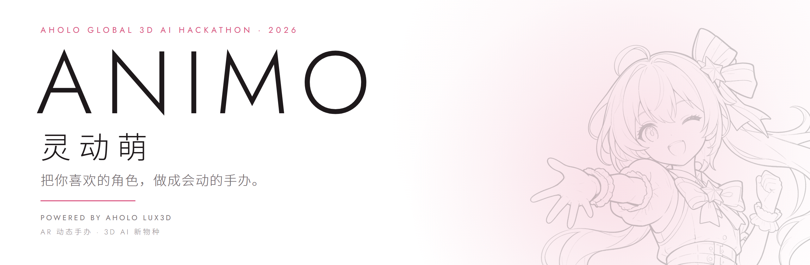

<p align="center">
  
</p>

# Animo 灵动萌

把人形角色做成会动的 AR 手办：拍一张或选一张全身人形角色图，Lux3D 负责生成 3D 模型、绑骨和动作，手机用 ARCore 把它放到真实桌面上。

客户端现在**直接调用 Lux3D OpenAPI**，不需要任何后端服务。API Key 由用户在设置页填写，只加密保存在本机。

---

## 1. 架构

```
手机（原生 Android）
  ├─ 首页应用内多帧扫描 / 相册导入 / 文字描述
  ├─ 图片规范化（EXIF、最长边 2048、透明底压白、JPEG）
  ├─ Lux3D 直连
  │    ├─ OUS 图片上传
  │    ├─ 手办化改写 + 四视角补全
  │    ├─ 图生 3D / 文生 3D
  │    ├─ /animations/rig 人形绑骨
  │    └─ /animations/retarget 动作重定向
  ├─ 下载 GLB，把 animation_1..N 重命名为 Idle_Loop / Walk_Loop / ...
  ├─ 本地收藏（模型 + 元数据，不依赖网络回放）
  └─ ARCore + Filament(SceneView)：平面放置、锚点、动作切换
```

后端、Docker、Galatea、Blender 兜底都已移除。Release 包不携带任何 Key；debug 包可从本地配置预填调试 Key。

---

## 2. 功能

- **三种入口**：首页粉色按钮进入应用内扫描、相册导入、胶囊输入框文字描述；没有单独的制作页
- **应用内扫描**：CameraX 全屏取景，轻按快门累计帧数（上限 12 帧），可回看 / 删除单帧；提交后把多帧一起上传 Lux3D 重建，再绑骨和套动作
- **手办化链路**：平面图先改写成 T-Pose 3D 手办造型，再补全四个视角，最后图生 3D；任一步失败自动降级
- **人形绑骨 + 动作**：Lux3D rig 后一次重定向 5 段动作
  `Idle_Loop`、`Walk_Loop`、`Punch_Jab`、`Hit_Chest`、`Death01`
- **AR 展示**：点桌面放置、自动贴平面、摸摸触发待机、双指缩放 / 绕平面法向旋转、默认相机方向补光 + 可选摄像头位置虚拟手电筒、按 Lux3D API 动作切换
- **液态玻璃 UI**：按 Mikhail Bespalov 的 Liquid Glass 实现——相机画面先微模糊、再用噪声位移做折射（AGSL RuntimeShader，等价于原作的 feGaussianBlur + feDisplacementMap），配 2px 白色光圈和柔和投影；胶囊一律使用真正的半圆端胶囊。手办管理页保持相机透出，并提供一个可拖拽旋转 / 缩放 / 自动播放待机的 3D 预览面板，点任意手办即可预览
- **失败可重试**：扫描 / 相册 / 文字任务的原始素材会保存在本地，失败或取消后可一键「重新生成」；多帧上传 3 路并发，状态轮询 1.5 秒，尽量缩短等待
- **生成期间保活**：有任务运行时启动前台服务，切到别的应用或锁屏不会因为进程被回收而白跑；即使进程被杀，素材仍在本地，重开后可重试
- **内置示例**：首次启动自动加入一个 T-Pose 示例手办（约 46.5 MB，2 段动作 Idle / Walk），不填 Key 也能直接 AR 展示和切换动作
- **本地收藏与任务**：GLB 存在手机里，断网也能回放；生成任务从创建那一刻起就进入手办管理页，失败或中断也会保留记录

---

## 3. 运行

### 3.1 手机要求

- Android 7.0+（minSdk 24），arm64
- 支持 ARCore 的设备
- 网络可访问 `api.aholo3d.cn`

### 3.2 构建

用 Android Studio 打开 `android/`，或在终端：

```bash
export ANDROID_HOME=/path/to/Android/Sdk
tools/build-android.sh          # 产物：根目录 Animo-<版本>.apk
tools/install-android.sh        # 构建 + 静默安装 + 启动
```

### 3.3 Lux3D API Key

在 App 的 **设置** 页填写自己的 Lux3D Key（[labs.aholo3d.cn](https://labs.aholo3d.cn)）。Key 用 Android Keystore 加密后保存在本机，不会上传到任何服务器，也不会进入 release APK。

调试时可以免手动输入：把 Key 写进 **已被 git 忽略** 的 `android/local.properties`：

```properties
LUX3D_DEBUG_API_KEY=你的调试Key
```

构建时只注入 debug 的 `BuildConfig.LUX3D_DEBUG_KEY`；release 构建始终为空。**debug APK 会包含这个调试 Key，只在本机安装，不要外发。**

### 3.4 发布包

```bash
tools/build-release.sh          # 签名 APK/AAB，产物在根目录
```

发布包不携带任何 Key，用户首次打开会进入设置页填写自己的 Key。内置示例手办无需 Key 即可体验。

---

## 4. 已知限制

- **只支持人形角色**：Lux3D 的 rig 接受正面全身的 T-Pose / A-Pose；双臂一前一后、抱胸、屈肘、坐姿或非人形角色会返回 `MODEL_NOT_RIGGABLE`，App 会提示换一张双臂水平张开的 T-Pose 图，不再交付静态模型。
- **需要用户自己的 Lux3D 额度**：建模、绑骨、动作都由 Lux3D 计费。
- **不再做对战**：联机和本地对战都已移除，展示页专注于动作切换、缩放旋转和打光。
- **没有本地绑骨兜底**：这是移除后端后的取舍；人形云端绑骨失败时会明确提示，而不是给一个不会动的模型。

---

## 5. 目录

```
android/                       原生客户端
  app/src/main/java/com/animo/ar/
    MainActivity.kt            入口、选图/拍照、页面路由
    AppState.kt                状态机、直接生成流程、本地收藏
    data/
      Lux3dClient.kt           Lux3D OpenAPI 直连客户端
      Pipeline.kt              上传 → 手办化 → 建模 → 绑骨 → 动作
      ImageTools.kt            图片规范化
      GlbTools.kt              GLB 检查与动作重命名
      RemoteImage.kt           网络图片/帖子配图下载
      SecureStore.kt           Android Keystore 加密存储
      PetStore.kt              本地模型与收藏索引
    ui/                        Compose 界面与 AR 播放器
tools/
  build-android.sh             构建 debug APK
  build-release.sh             构建签名 release APK/AAB
  install-android.sh           构建 + 安装 + 启动
  app-icon/                    图标源图
```

---

## 6. 验证

已用真实 Key 跑通：

- 文生 3D：T-Pose 少女手办，约 84 秒出模
- 绑骨：约 188 秒，52 骨
- 动作重定向：5 段动作全部成功（Idle / Walk / Punch / Hit / Death），约 12 秒
- 最终 GLB：15.4 MB，21,638 三角面，`skins=1`，组合动作名为 `animation_1..5`，由 App 重命名后交付

```bash
cd android
./gradlew testDebugUnitTest     # GLB 动作重命名等单元测试
./gradlew assembleDebug
```

真机验证项：首次启动填 Key、T-Pose 人形图生成、绑骨+5 段动作、AR 桌面放置、断网回放。

---

## 7. 许可与致谢

- 3D 生成 / 绑骨 / 动作：[Aholo Lux3D](https://labs.aholo3d.cn/api-docs/api-reference)
- AR / 渲染：Google ARCore、Filament、SceneView（Apache-2.0 / MIT）
- 图标插画：Animo × Lux3D
