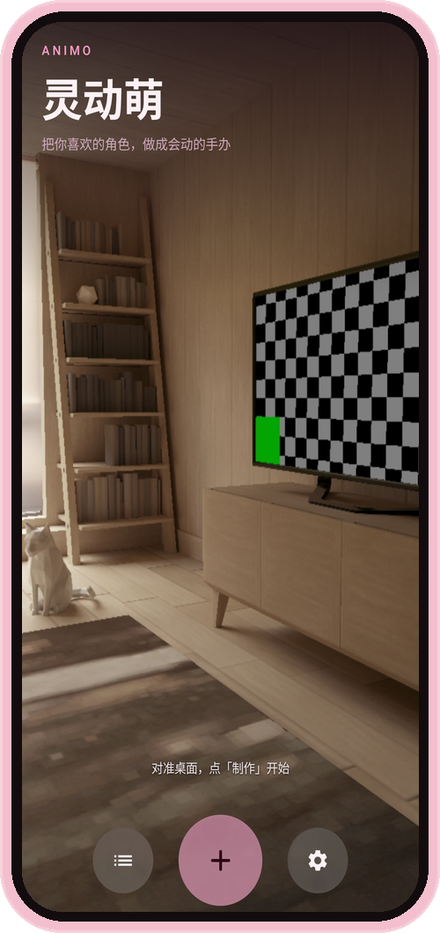
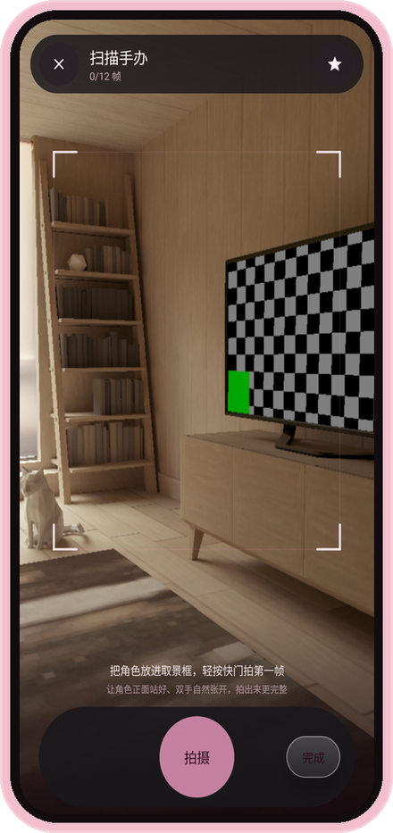
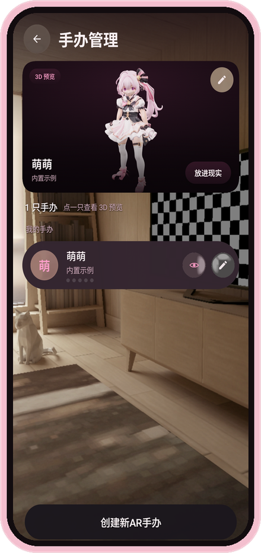

<p align="center">
  
</p>

# Animo 灵动萌

**把你喜欢的角色，做成会动的手办，放到你的桌子上。**

Animo 是一款原生 Android AR 手办应用。拍一张照片、从相册选一张图，或用一句话描述，Lux3D 会完成 3D 建模、绑骨和动作；手机用 ARCore 把手办放进真实空间，随时切换动作、调整光线、分享给朋友。

`v0.9.60` · Aholo Global 3D AI Hackathon 2026 · Android 7.0+ / arm64 / ARCore

<p align="center">
  
  &nbsp;
  
  &nbsp;
  
</p>
<p align="center"><sub>相机首页 · 应用内扫描 · 手办管理</sub></p>

> “不是把模型放进一个 3D 浏览器，而是让我的角色站在我的桌子上。”

## 为什么是 Animo

- **从一张照片开始。** 应用内多帧扫描、相册导入、文字描述三种入口，不需要任何建模经验。
- **不注册、不登录。** 内置示例打开即玩；自定义生成只需要你自己的 Lux3D Key。
- **等待是看得见的。** 建模成功就立即出现在手办管理页，可以先看 3D 预览、先进 AR；走路动作在后台继续生成。
- **动作可以慢慢加。** 支持 10 种动作；不用一次等完，想要跳舞、挥剑、坐下时再单独生成。
- **每个手办都有 3D 预览。** 管理页直接拖拽旋转、缩放、自动播放待机，点“放进现实”进入 AR。
- **放进现实，而不是停在屏幕里。** ARCore 平面放置、贴合桌面、双指缩放、绕平面旋转，默认面向你。
- **分享得出去。** 导出模型文件（GLB）、快捷分享给微信好友、录制 6 秒动态照片发朋友圈。

## 三步做出你的手办

1. **拍、选，或描述**<br>
   首页点粉色按钮进入应用内扫描；也可以从相册导入，或在胶囊输入框里描述角色。
2. **等它变成手办**<br>
   Lux3D 依次完成手办化改写、参考视角补全、图生 3D、人形绑骨和动作。建模成功后会立即进入手办管理页，不需要等所有动作跑完。
3. **放进现实**<br>
   在管理页点“放进现实”，对着桌面找平面，点一下放置。用“挪一挪”移动，双指缩放/旋转，切换动作，打开补光，拍一段 6 秒动态照片。

> 第一次打开会自带「萌萌」示例：不填 Key 也能直接进入 AR、切换待机和走路。

## 功能一览

### 创建

| 入口 | 适合 |
| --- | --- |
| 应用内扫描 | 手边有玩偶、手办、手作，绕角色拍 8–12 帧 |
| 相册导入 | 已经有一张全身角色图 |
| 文字描述 | 还没有图，先用一句话描述角色 |

- 自动补全参考视角，再生成 3D；任一步失败会自动降级或提示重新生成。
- 原始素材保留在本地，失败或中断后可以一键“重新生成”。
- 生成任务在前台服务中保活，切到别的应用或锁屏也能继续跑。

### 账号与 API Key

- 设置页内登录 Aholo 官方账号，直接创建、管理 API Key。
- 登录后显示可用额度，支持刷新与打开官方用量页。
- 账号密码只在 Aholo 官方页面输入，App 不保存；Key 可一键从剪贴板填入。

### 手办管理

- 建模成功即落库；未完成、失败的任务也会保留记录。
- 每个手办都有 3D 预览，可拖拽旋转、缩放、自动播放待机。
- 眼睛图标查看，铅笔图标重命名或删除。
- 记录生成耗时；失败任务可重新生成。

### AR 展示

- ARCore 平面检测与锚点放置，自动贴合桌面。
- 默认面向镜头；双指缩放、绕平面法向旋转。
- 10 种动作：待机、走路、小跑、跳舞、点头、跳跃、坐下、出拳、挥剑、受击。
- 走路随模型在后台生成，其余动作按需添加；每个手办最多 10 段。
- 默认以相机方向补光，也可以打开摄像头位置的虚拟手电筒。

### 分享

- 导出 GLB 模型文件。
- 快捷分享给微信好友；未安装微信时走系统分享。
- 录制 6 秒动态照片（MP4），Android 10+ 可直接保存到相册，并分享到微信或其他应用。

## 它如何工作

```text
照片 / 相册 / 文字
        ↓
Lux3D OpenAPI（手机直连）
  手办化改写 → 四视角补全 → 图生 3D → 人形绑骨 → 动作重定向
        ↓
GLB 下载到手机 → 本地收藏 → ARCore + Filament 放进现实
```

没有自建后端。上传、任务轮询、模型下载、动作重命名都在手机端完成；Release 包不包含任何 API Key。

## 隐私与数据

- API Key 使用 Android Keystore 加密，只保存在本机。
- 手办模型和任务记录保存在手机本地，已下载的手办断网也能回放。
- 相机画面只用于取景、扫描和液态玻璃背景，不上传到任何 Animo 服务器。
- 只有你主动提交的图片、多帧照片或文字描述会上传到 Lux3D，用于生成模型和动作。

## 开始使用

### 安装

安装 `Animo-0.9.60.apk`（arm64，随交付包提供；也可以按下方从源码构建）。首次打开允许相机权限；内置「萌萌」无需 Key。

创建自己的手办前，在 **设置 → Lux3D API Key** 填入自己的 Key（[labs.aholo3d.cn](https://labs.aholo3d.cn)）。

### 从源码构建

```bash
export ANDROID_HOME=/path/to/Android/Sdk
tools/build-android.sh          # 产物：根目录 Animo-0.9.60.apk
tools/install-android.sh        # 构建 + 安装到已连接设备
```

也可以直接用 Android Studio 打开 `android/`。

调试时可以在已被 git 忽略的 `android/local.properties` 中写入：

```properties
LUX3D_DEBUG_API_KEY=你的调试Key
```

这个 Key 只会注入 debug 包；release 包始终为空。

## 适合什么样的角色

为了绑骨稳定，建议使用**正面全身、双臂自然展开、双腿分开站稳**的人形角色图。抱臂、屈肘、坐姿、遮挡严重或非人形角色可能无法生成动作，App 会提示换一张图。

## 项目结构

```text
android/                     原生 Android 客户端（Kotlin + Jetpack Compose）
  app/src/main/java/com/animo/ar/
    ui/                      相机首页、扫描、管理、AR 播放、液态玻璃
    data/                    Lux3D 客户端、生成流水线、GLB 处理、本地存储
    GenerationService.kt     生成任务前台保活
    ShareRecordService.kt    6 秒动态照片录制
  app/src/main/assets/models/sample.glb   内置「萌萌」
tools/                       构建、安装、签名脚本
docs/                        README 横幅与界面图
```

## 已知边界

- 自定义生成需要网络和 Lux3D API 额度；内置示例不需要。
- 每个手办最多 10 段动作（Lux3D 单次 retarget 上限）。
- AR 展示需要设备支持 ARCore；不支持 ARCore 的设备仍可管理手办、查看 3D 预览。
- 液态玻璃与相机帧率会因设备性能不同而有差异。

## 致谢

- 3D 生成 / 绑骨 / 动作：[Aholo Lux3D](https://labs.aholo3d.cn/api-docs/api-reference)
- AR / 渲染：Google ARCore、Filament、SceneView
- 图标插画：Animo × Lux3D
